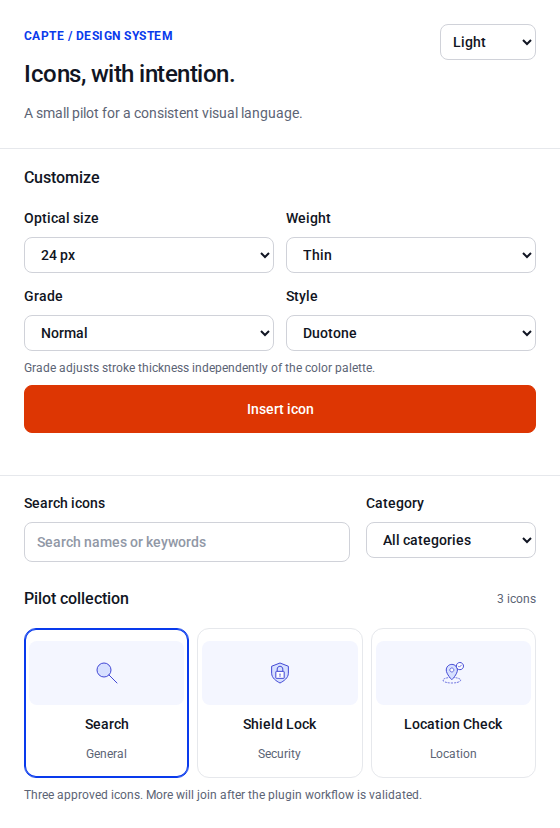

# Capte Icons

**Figma icons, with intention.** A shared Capte icon catalog, live-editing Figma plugin, and companion icon explorer.

[](https://github.com/john-l-hansen/capte-icons/actions/workflows/check.yml)

**Current version: 0.1.3 · Team preview · Three pilot icons**

[Download the Figma plugin](https://github.com/john-l-hansen/capte-icons/releases/download/v0.1.3/capte-icons-figma-plugin-0.1.3.zip) · [Release notes](https://github.com/john-l-hansen/capte-icons/releases/tag/v0.1.3) · [Installation guide](INSTALL.md) · [Usage guide](docs/usage.md) · [Roadmap](docs/roadmap.md)

This preview is for trying the workflow and collecting team feedback. It includes **Search, Shield Lock, and Location Check**. The rest of the approved icon library will follow in reviewed batches. It is a manually installed development plugin; a Figma Community installation link is a later milestone.

<p align="center"></p>

## For the team: install and try it

**You need Figma Desktop. You do not need Node.js, an API key, or access to the source design file.**

1. Download the **capte-icons-figma-plugin-0.1.3.zip** asset from the release above. GitHub's automatic “Source code” downloads are for developers.
2. Extract the ZIP into a permanent folder, such as `Documents/Capte Icons`. Keep `manifest.json`, `code.js`, and `ui.html` together.
3. Open a Figma Design file in Figma Desktop. Choose **Plugins → Development → Import plugin from manifest…** and select that `manifest.json`.
4. Run **Capte Icons — Pilot** from **Plugins → Development**.

[Installation, updating, and troubleshooting →](INSTALL.md)

## How it works

- Choose an icon and settings, then click **Insert icon** to create an editable vector icon.
- Select an inserted Capte icon—or a vector inside it—to load its settings. Controls and catalog choices update it **live**.
- **Insert icon always creates an additional icon**, even when another icon is selected.
- With no Capte icon selected, controls change the preview until you insert.

| Control | Options |
| --- | --- |
| Optical size | 20, 24, 40, 48 px |
| Weight | Thin, Medium, Heavy |
| Grade | Dark, Normal, Emphasis |
| Style | Outline, Filled, Duotone |
| Color, top-right | Light, Dark |

Grade changes stroke thickness; Color changes the palette. They are independent. Approved small-size geometry preserves compact details. The three icons support **648 configurations** from 36 geometry templates and 24 stroke profiles.

Live editing retains the root frame, parent, position, and rotation while replacing generated children. **Manual edits inside an icon are overwritten when its settings change.** Unrelated artwork, multiple selections, and locked root layers are not live-edited.

Inserted icons are editable snapshots. They are not linked library instances, do not bind to the destination file's variables, and do not automatically change when the plugin or source library is updated.

## Preview status and feedback

| Verified | Still to confirm |
| --- | --- |
| Earlier pilot launch and initial appearance confirmed by the project owner | Full 0.1.3 live-editing and undo/redo pass inside Figma Desktop |
| TypeScript, 13 renderer/controller tests, all 648 configurations, both builds | Detailed artwork comparison in the editor |
| Chromium checks: controls, rapid edits, target switching, downloads, preferences, layouts | Full catalog expansion |
| Light/Dark interfaces visually reviewed against exported tokens | Community distribution and production website |

Automated controller tests use a mocked Figma API. The [editor acceptance checklist](docs/acceptance.md) records the remaining checks. Try the preview in a working copy of a design file and report the icon, settings, version, and what happened using [a bug report](https://github.com/john-l-hansen/capte-icons/issues/new?template=bug_report.yml).

## Project guide

| I want to… | Start here |
| --- | --- |
| Install or update the plugin | [Installation](INSTALL.md) |
| Understand controls and live editing | [Usage](docs/usage.md) |
| See what's changed | [Changelog](CHANGELOG.md) and [0.1.3 notes](releases/0.1.3.md) |
| See what's next | [Roadmap](docs/roadmap.md) |
| Build or contribute | [Contributing](CONTRIBUTING.md) |
| Understand shared artwork and rendering | [Architecture](docs/architecture.md) |
| Refresh interface tokens from Figma | [Design tokens](docs/design-tokens.md) |
| Package the next team preview | [Maintainer release guide](docs/releasing.md) |

## For developers

Requires Node.js **22.18+** and npm. Release packaging also uses Python 3.

```sh
npm ci
npm run check
npm run dev
```

Open **http://127.0.0.1:4173** for the local icon explorer and documentation. It supports SVG download/copy. The preview server builds once; restart it after code changes. The website has not been deployed.

```sh
npx playwright install chromium --only-shell
npm run test:browser
npm run package:release
```

`npm run build` outputs the plugin under `apps/figma-plugin/dist` and website under `apps/docs/dist`. Import the built manifest directly when developing. The assigned plugin ID is `1692625788103724528`. Forks should create their own development plugin and use `npm run configure:plugin -- YOUR_NUMERIC_FIGMA_PLUGIN_ID` before rebuilding.

| Path | Purpose |
| --- | --- |
| `packages/icons` | Approved catalog, renderer, validation, and search |
| `packages/ui` | Shared explorer, exported design tokens, bundled fonts |
| `apps/figma-plugin` | Figma controller and UI entry point |
| `apps/docs` | Website explorer and documentation |
| `scripts` | Build, packaging, and read-only Figma exports |
| `tests` | Renderer, controller, and browser checks |

## Design source and delivery

- [Approved Figma pilot](https://www.figma.com/design/oFZw7IVtiURZG2x5XhAKyD/Capte-Design-System?node-id=3637-27)
- [Complete icon library](https://www.figma.com/design/oFZw7IVtiURZG2x5XhAKyD/Capte-Design-System?node-id=3614-1889)

Figma is the artwork approval surface. The versioned catalog powers both clients. Interface styles use exported Capte semantic colors, Roboto text styles, spacing, and radii. Tokens and fonts are bundled, so the plugin runs offline and requests no network access. Token and catalog changes require a rebuilt plugin; they do not sync automatically into installed copies.

GitHub Releases are the download source for team previews. A future Capte brand assets page should link to that release asset rather than maintain a separate copy. Community publication, website deployment, and a project distribution license remain separate decisions. Bundled font notices are retained in `packages/ui/fonts` and in the build.
